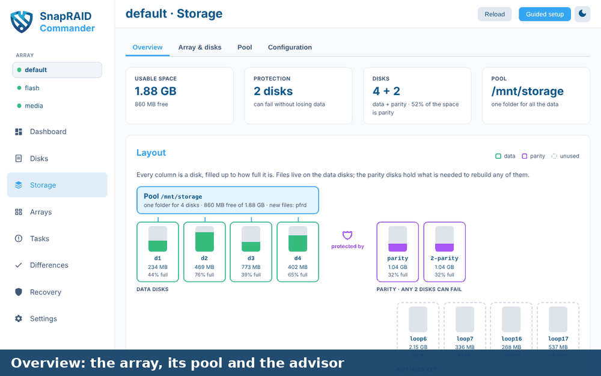
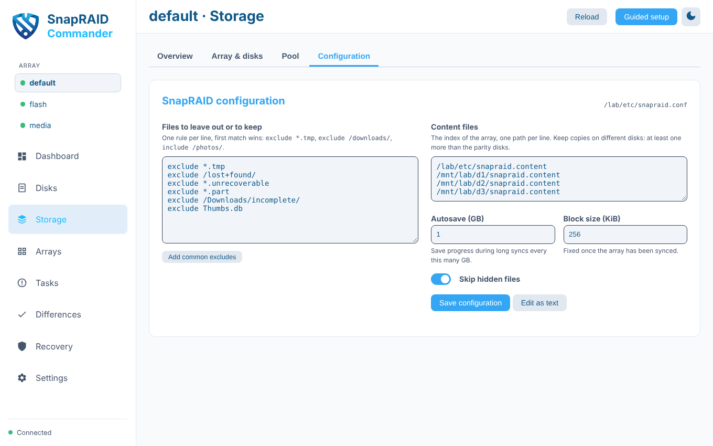
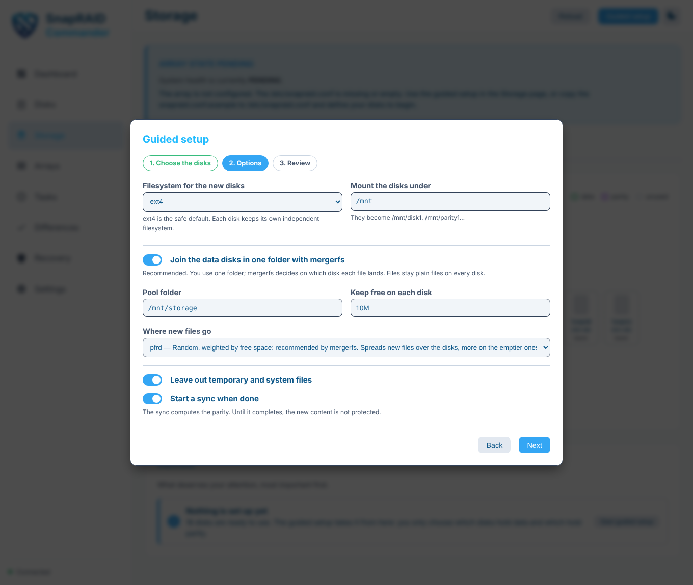
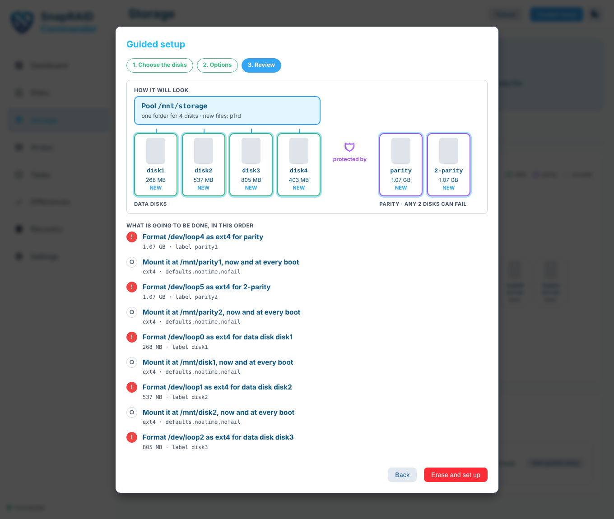
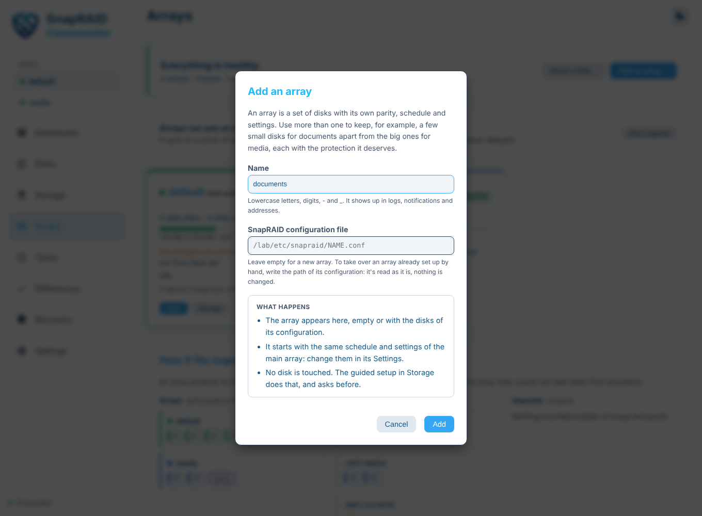

# SnapRAID lab

A Docker lab with emulated disks, to try and to test the **Storage** page that the
[`storage` branch of paleka/snapraid-daemon](https://github.com/paleka/snapraid-daemon/tree/storage)
adds to the web UI of SnapRAID Daemon.

## Whose work is what

| Project | Author | Where |
|---|---|---|
| SnapRAID, the engine | Andrea Mazzoleni | <https://github.com/amadvance/snapraid>, <https://www.snapraid.it/> |
| SnapRAID Daemon and its web UI | Andrea Mazzoleni | <https://github.com/amadvance/snapraid-daemon>, <https://www.snapraid.it/ui> |
| Storage page (fork of the daemon) | Robert Paleka | <https://github.com/paleka/snapraid-daemon/tree/storage>, see its `CHANGES-FORK` |
| This lab | Robert Paleka | this repository |

The fork and this lab are unofficial: they are not part of SnapRAID and are not reviewed or
endorsed by its author. Report problems with them in these two repositories, not to the SnapRAID
project. For SnapRAID itself see its [manual](https://www.snapraid.it/manual) and its
[support page](https://www.snapraid.it/support).

The lab and the fork were written with the help of an AI coding assistant (Claude).

## Screenshots

The Storage page inside SnapRAID Commander, the web UI of SnapRAID Daemon by Andrea Mazzoleni.
Everything outside the Storage page, and the look of the UI, is his work. The pictures are taken
from this lab: the disks are 512 MB loop devices.

| | |
|---|---|
| **Overview**: layout of the array and of the pool, and the advisor  | **Array & disks**: every disk, with replace, remove and format  |
| **Pool**: mergerfs branches, policy, balance, duplicates, file browser  | **Configuration**: the SnapRAID configuration, as a form or as text  |
| **Guided setup, 1**: choose the disks and their role  | **Guided setup, 2**: options  |
| **Guided setup, 3**: review of what is going to be done, before anything is erased  | **Create a pool**  |
| **Replace a disk**: the steps, and the confirmation to type  | **Balance**: what happens and what does not change  |
| **Degraded array**: a disk came back empty  | **Recover**: fix, check and sync in one command  |
| **Recovery in the Tasks page**  | **Arrays**: every array, the pools and what protects them  |
| **Add an array**  | **Move a disk to another array**, with its files  |
| **Storage of the second array**: the sidebar chooses the array  | |

## Versions

| What | Version |
|---|---|
| SnapRAID engine | release 15.1, unmodified, commit `4054832` (checked by the `Dockerfile`) |
| SnapRAID Daemon | the checkout next to this folder; all the tests last run with `storage` at `98714a1` |

## Start

Put the two checkouts side by side:

    git clone -b storage https://github.com/paleka/snapraid-daemon.git
    git clone https://github.com/paleka/snapraid-lab.git
    cd snapraid-lab
    docker compose up --build

Then open http://localhost:7627

A daemon checkout somewhere else: `DAEMON_SRC=/path/to/snapraid-daemon docker compose up --build`.
Docker Compose 2.17 or later is needed (`additional_contexts`).

Stop with Ctrl-C (or `docker compose down`). The array survives restarts.
`docker compose down -v` throws it away and the next start builds a new one.

## Trying the Storage page

The lab starts with a working array (4 data, 2 parity) plus two blank spare disks, so in
**Storage** you can create the mergerfs pool, add a disk, replace one and remove one.

To try the first-time setup instead, start from empty disks:

    docker compose down -v
    LAB_PRESET=blank docker compose up --build

and use **Storage → Guided setup**. What the UI sets up (filesystems, `/etc/fstab`, the pool,
`snapraid.conf`) lives in the lab volume and is mounted again at the next start.

The daemon runs with `net_storage_admin = 1`, the option of the fork that lets the UI change
disks, mounts, pools and the SnapRAID configuration. It is off by default outside the lab.

More things to try there:

    docker exec snapraid-lab lab fill /mnt/lab/d1 150   # unbalance the pool, then Pool → Balance
    docker exec snapraid-lab lab dup /mnt/storage       # make duplicates, then Pool → Look for duplicates
    docker exec snapraid-lab lab reformat d3            # a "replaced" disk: the array goes DEGRADED, then Overview → Recover

Storage administration also needs the daemon protected (loopback only, `net_auth_credential` or
`net_acl`). The lab uses a `net_acl` that lets in private addresses only, because requests arrive
from the Docker network. On a real machine prefer `net_auth_credential`.

## Tests

Three layers, from the fastest (the first two also cover more arrays: `test/ui/arrays.test.mjs`
and the layout tests of the selftest):

| What | Where | Run |
|---|---|---|
| Daemon selftest: validation of everything coming from the network, mount table parsing, fstab editing, pool helpers | fork, `daemon/storage.c` (`storage_selftest`) | `make check`, or `snapraidd test` |
| Logic of the Storage page: configuration parsing, disk states, guided setup rules, advisor | fork, `test/ui/storage.test.mjs` | `make check`, or `node --test test/ui/storage.test.mjs` |
| Storage API end to end, on the emulated disks: format, mount, fstab, pool, browse, duplicates, balance, recovery of a replaced disk, permissions | here, `tests/api-test.sh` | see below |

The first two run at every image build (a failure stops the build). The third formats disks,
so it has its own throwaway lab:

    docker compose -f docker-compose.test.yml up --build --abort-on-container-exit --exit-code-from tests
    docker compose -f docker-compose.test.yml down -v

It prints one line per check and exits with the number of failures.

`tests/multi-array-test.sh` covers more arrays in the same daemon, with five data disks, two
parity disks and a spare of 256 MB:

    docker compose -f docker-compose.arrays.yml up --build --abort-on-container-exit --exit-code-from tests
    docker compose -f docker-compose.arrays.yml down -v

It creates a second array and refuses the names, paths and configurations that would clash;
checks that a disk cannot end in two arrays, as data, parity or content; that every array has its
own tasks, logs, options and recovery; that a sync waits for the one of another array unless they
are allowed to run together, while a probe is never delayed; three pools with what protects every
branch, and a pool over two arrays; that a balance and a sync of the same disks keep away from
each other; arrays added and removed by hand with a reload, and from the API; a data disk moved
with its files to another array and rebuilt there; and both arrays back after a restart.

A fourth one, `tests/mixed-size-test.sh`, checks that disks of different sizes work as SnapRAID
promises, on data disks of 256, 512, 1024 and 384 MB with 1024 MB parity:

    docker compose -f docker-compose.sizes.yml up --build --abort-on-container-exit --exit-code-from tests
    docker compose -f docker-compose.sizes.yml down -v

It covers the loss of the largest and the smallest disk together, a parity level split over two
disks each smaller than the largest data disk, a pool balanced by fill level, a data disk replaced
by one larger than the parity, what happens when that disk then outgrows the parity (the sync stops
with the list of the files that do not fit, and what was synced before stays recoverable), and a
128 MB disk.

## What is emulated

- Every disk is a sparse image file, attached as a loop device with a partition table,
  formatted ext4 and mounted on `/mnt/lab/<disk>`. To SnapRAID these are separate physical disks.
- Default array: 4 data disks (`d1`..`d4`), 2 parity disks (`p1`, `p2`), 2 blank spares, 512 MB each.
  Change `LAB_DATA_DISKS`, `LAB_PARITY_DISKS`, `LAB_SPARE_DISKS`, `LAB_DISK_SIZE_MB` in `docker-compose.yml`
  (then `docker compose down -v` so the array is rebuilt).
  `LAB_DISK_SIZES` gives single disks their own size, for example `"d1=256 d3=1024 p1=1024"`.
- A second array named `media`: 2 data disks (`m1`, `m2`) and 1 parity disk (`q1`), with its own
  SnapRAID configuration in `/lab/etc/snapraid/media.conf` and its own daemon options in
  `/lab/etc/snapraidd.d/media.conf`. `LAB_MEDIA_DATA_DISKS: "0"` gives a lab with one array only.
- One disk mounted but in no array (`x1`, `LAB_SCRATCH_DISKS`), and with `LAB_POOLS: "1"` three
  mergerfs pools: `/mnt/storage` over the first array, `/mnt/media` over the second, and
  `/mnt/scratch` over the disk that has no parity.
- `smartctl` is replaced by a fake that answers from `/lab/smart/<disk>.env`: model, serial,
  temperature, power-on hours, reallocated sectors, spin-down state. `d3` starts with a few
  reallocated sectors and runs hot; `d4` is an SSD.
- On first start the data disks get sample files, the array is synced once, and a few files are
  then added, changed, moved and deleted so the Differences page has content.

The container must be `privileged` (loop devices and mounts). If loop devices cannot be used it
falls back to tmpfs disks: the UI still works, but without SMART data and without persistence.
Run it only on a machine you use for development.

## Working on the UI

`commander/` and `brutale/` of the daemon checkout are mounted into the container and the daemon
runs with `-N` (no cache): edit the HTML/CSS/JS and reload the browser.
Switch UI with `LAB_UI: "brutale"` in `docker-compose.yml`.

Changes to the C sources of the daemon need `docker compose up --build`.

REST API: `http://localhost:7627/snapraid/v1/{state,array,disks,tasks,activity,system,storage}`,
`/snapraid/v2/config`, Prometheus at `/metrics`. Full spec in `snapraidd.yaml` of the daemon.

## Making things happen

    docker exec snapraid-lab lab status
    docker exec snapraid-lab lab churn                 # new, changed, moved, deleted files
    docker exec snapraid-lab lab corrupt d2            # silent corruption, found by a scrub
    docker exec snapraid-lab lab delete d1 60          # mass deletion: trips the sync safety threshold
    docker exec snapraid-lab lab wipe d3               # an empty "replaced" disk to recover from the UI
    docker exec snapraid-lab lab smart d1 REALLOCATED=120 TEMP=58
    docker exec snapraid-lab lab smart p1 FAILING=1

SMART changes show up at the next probe (every minute).

## Files

| File | Purpose |
|---|---|
| `Dockerfile` | builds the engine and the daemon, installs the fake smartctl |
| `docker-compose.yml` | array size, UI choice, port, volumes |
| `docker-compose.test.yml` | throwaway lab that runs `tests/api-test.sh` |
| `docker-compose.sizes.yml` | throwaway lab of mixed disk sizes that runs `tests/mixed-size-test.sh` |
| `docker-compose.arrays.yml` | throwaway lab that runs `tests/multi-array-test.sh` |
| `entrypoint.sh` | creates and mounts the disks, writes the configs, starts `snapraidd` |
| `fake-smartctl`, `smartctl-launcher.c` | SMART emulation (SnapRAID only runs real binaries, hence the launcher) |
| `lab` | the helper used above |
| `docs/screenshots/` | the pictures of this page |

Array and daemon configs live in the `lab` volume: `/lab/etc/snapraid.conf`, `/lab/etc/snapraidd.conf`.

## Licence

GPL-3.0-or-later, the same licence as SnapRAID and SnapRAID Daemon. See `LICENSE`.
