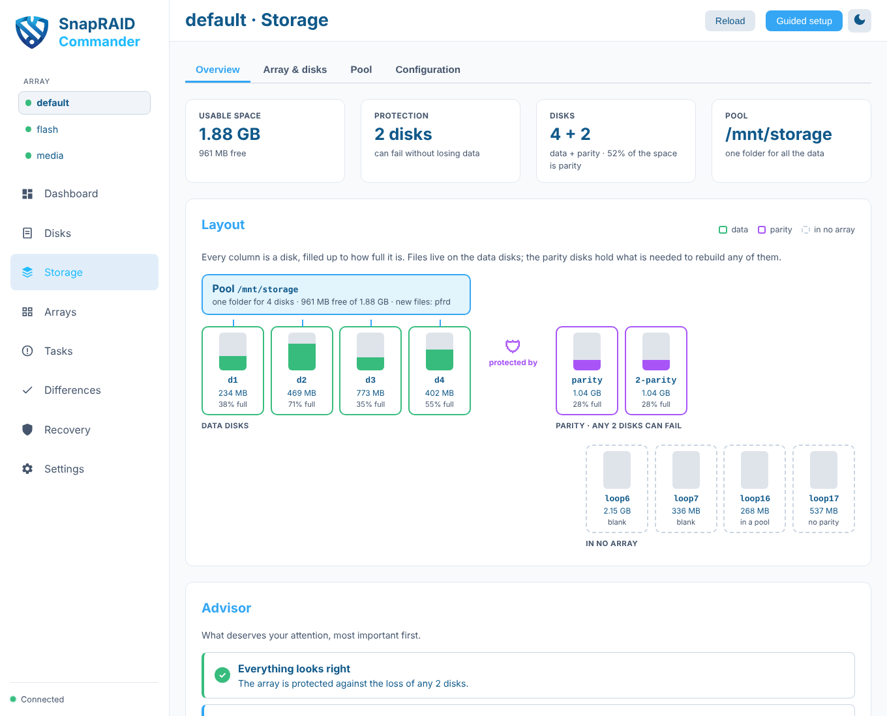
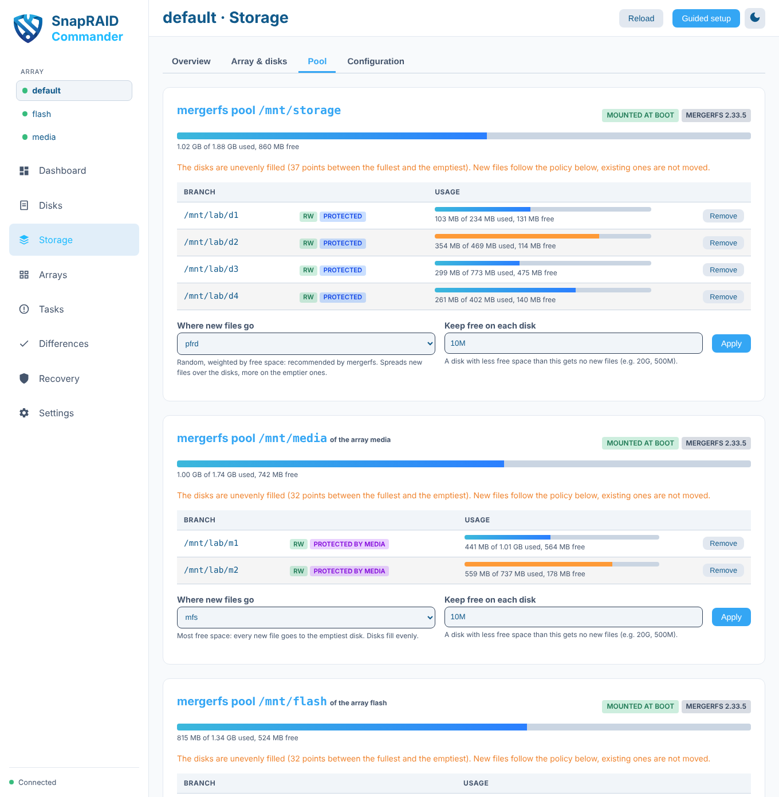
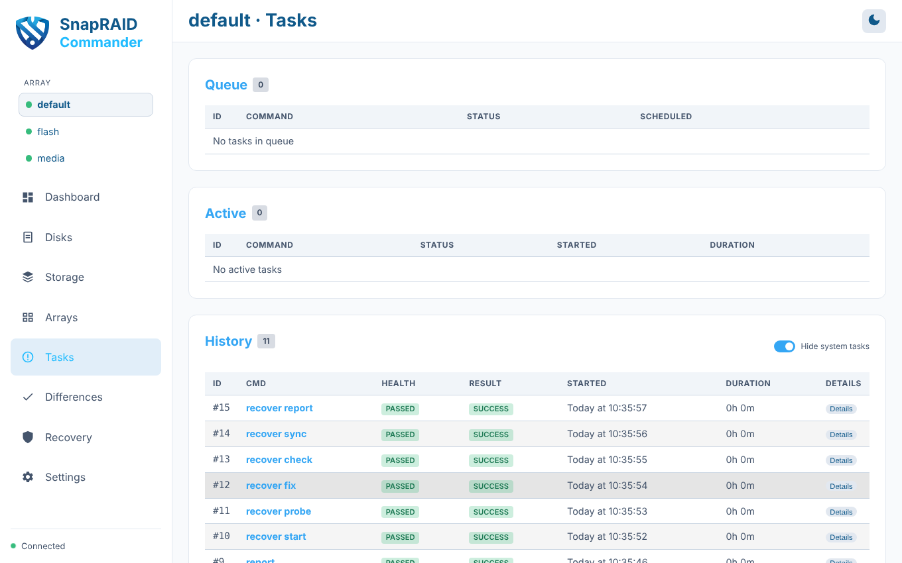
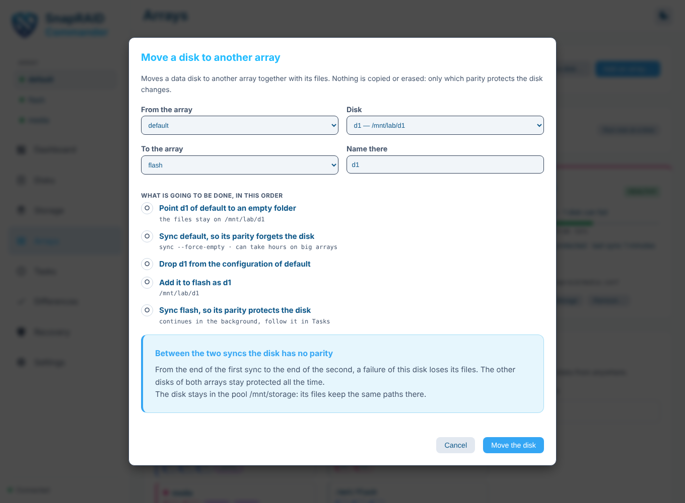
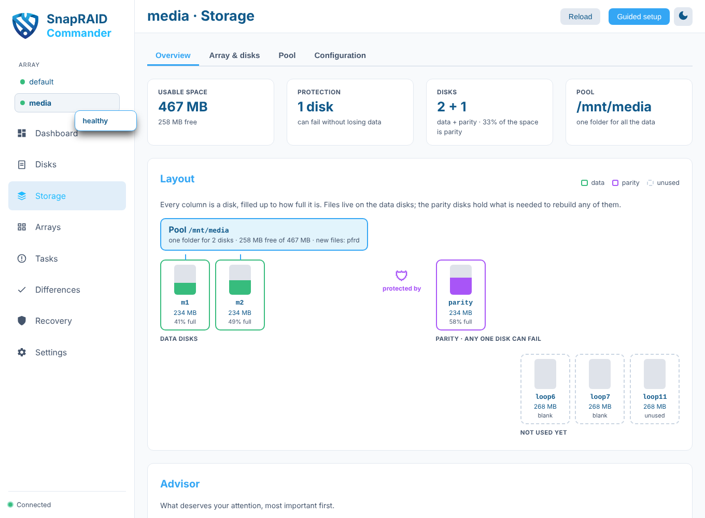
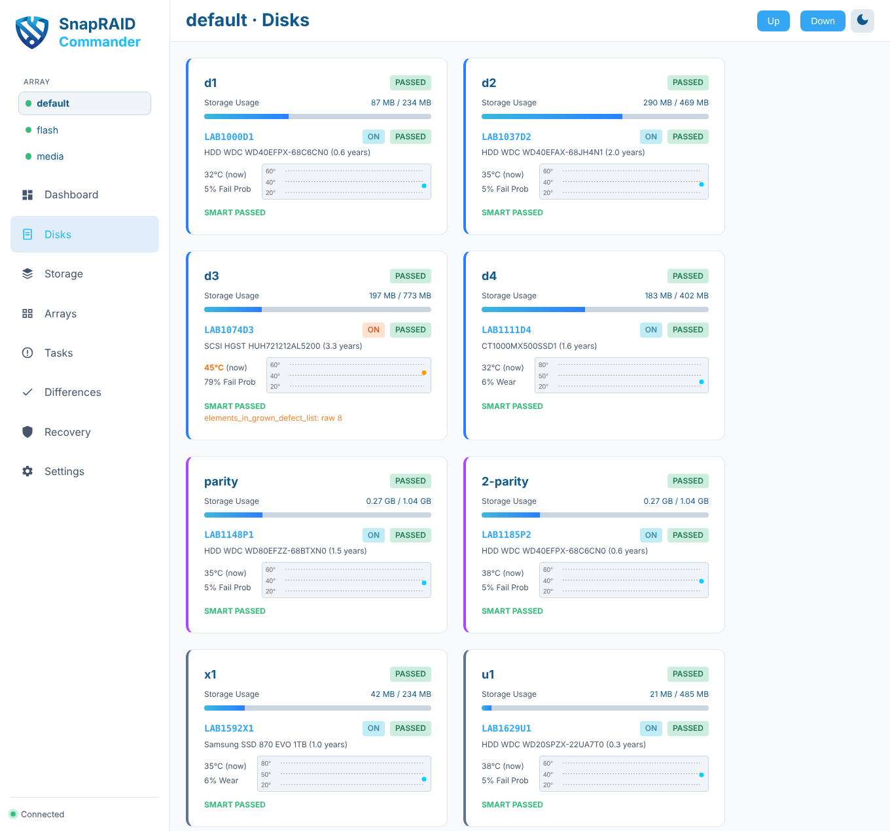
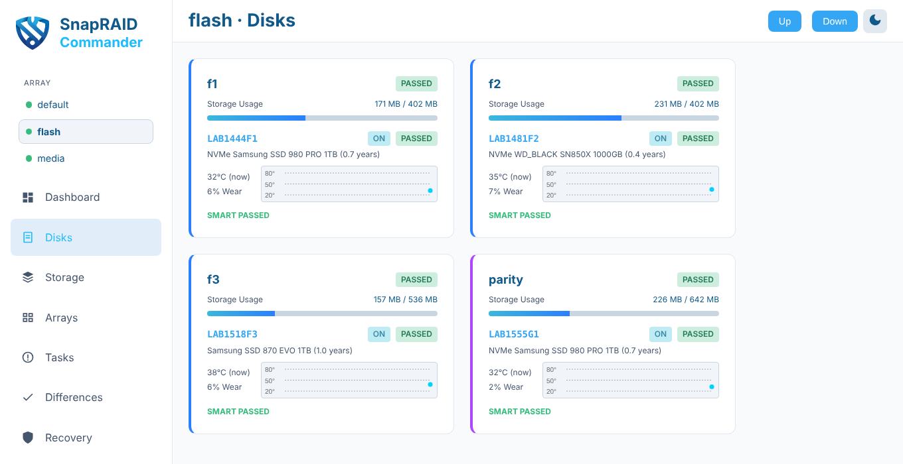

# SnapRAID lab

A Docker lab with emulated disks, to try and to test the **Storage** page that the
[`storage` branch of paleka/snapraid-daemon](https://github.com/paleka/snapraid-daemon/tree/storage)
adds to the web UI of SnapRAID Daemon.

Out of the box it is a showcase: three arrays in one daemon, four mergerfs pools, eighteen disks
of different sizes, kinds (HDD, shingled HDD, SAS, SATA SSD, NVMe, USB) and filesystems (ext4,
XFS, Btrfs), and configurations that use most options of SnapRAID and of its daemon. See
[The showcase lab](#the-showcase-lab).

## Whose work is what

| Project | Author | Where |
|---|---|---|
| SnapRAID, the engine | Andrea Mazzoleni | <https://github.com/amadvance/snapraid>, <https://www.snapraid.it/> |
| SnapRAID Daemon and its web UI | Andrea Mazzoleni | <https://github.com/amadvance/snapraid-daemon>, <https://www.snapraid.it/ui> |
| Storage page (fork of the daemon) | Robert Paleka | <https://github.com/paleka/snapraid-daemon/tree/storage>, see its `CHANGES-FORK` |
| This lab | Robert Paleka | this repository |

The fork and this lab are unofficial: they are not part of SnapRAID and are not reviewed or
endorsed by its author. Report problems with them in these two repositories, not to the SnapRAID
project. For SnapRAID itself see its [manual](https://www.snapraid.it/manual) and its
[support page](https://www.snapraid.it/support).

The lab and the fork were written with the help of an AI coding assistant (Claude).

## Screenshots

The Storage page inside SnapRAID Commander, the web UI of SnapRAID Daemon by Andrea Mazzoleni.
Everything outside the Storage page, and the look of the UI, is his work. The pictures are taken
from this lab: the disks are loop devices of a few hundred MB.

| | |
|---|---|
| **Overview**: layout of the array and of the pool, and the advisor  | **Array & disks**: every disk, with replace, remove and format  |
| **Pool**: mergerfs branches, policy, balance, duplicates, file browser  | **Configuration**: the SnapRAID configuration, as a form or as text  |
| **Guided setup, 1**: choose the disks and their role  | **Guided setup, 2**: options  |
| **Guided setup, 3**: review of what is going to be done, before anything is erased  | **Create a pool**  |
| **Replace a disk**: the steps, and the confirmation to type  | **Balance**: what happens and what does not change  |
| **Degraded array**: a disk came back empty  | **Recover**: fix, check and sync in one command  |
| **Recovery in the Tasks page**  | **Arrays**: every array, the pools and what protects them  |
| **Add an array**  | **Move a disk to another array**, with its files  |
| **Storage of the second array**: the sidebar chooses the array  | **Kinds of disk**: HDD, SAS, SSD and two disks outside the array, in the Disks page of the daemon  |
| **An array of flash disks**: NVMe and SSD, with their wear  | **A split parity**: one parity level over two disks, the first one full  |

The Arrays picture and the last three are taken from the showcase lab; the others from an
earlier lab of equal 512 MB disks.

## Versions

| What | Version |
|---|---|
| SnapRAID engine | release 15.1, unmodified, commit `4054832` (checked by the `Dockerfile`) |
| SnapRAID Daemon | the checkout next to this folder; all the tests last run with `storage` at `98714a1` |
| mergerfs, xfsprogs, btrfs-progs | the ones of Debian 12 |

## Start

Put the two checkouts side by side:

    git clone -b storage https://github.com/paleka/snapraid-daemon.git
    git clone https://github.com/paleka/snapraid-lab.git
    cd snapraid-lab
    docker compose up --build

Then open http://localhost:7627

A daemon checkout somewhere else: `DAEMON_SRC=/path/to/snapraid-daemon docker compose up --build`.
Docker Compose 2.17 or later is needed (`additional_contexts`).

Stop with Ctrl-C (or `docker compose down`). The arrays survive restarts.
`docker compose down -v` throws them away and the next start builds new ones.

The first start takes a minute or two: it writes about 2 GB of sample files and syncs the three
arrays. The disk images are sparse and take about 3 GB in the Docker volume.

To try the login of the daemon (`net_auth_credential`): `LAB_AUTH=lab:secret docker compose up --build`.

A small lab, one array of equal disks (4 data, 2 parity) with two blank spares, and nothing else:

    docker compose -f docker-compose.simple.yml up --build

## The showcase lab

`docker-compose.yml` describes it, and every line of it can be changed (then `docker compose down -v`,
so the lab is built again). `docker exec snapraid-lab lab disks` prints this table from the running lab.

| Disk | Array | Role | Kind | Size | Filesystem |
|---|---|---|---|---|---|
| `d1` | default | data | HDD 5400 rpm | 256 MB | ext4 |
| `d2` | default | data | shingled HDD (SMR) | 512 MB | XFS |
| `d3` | default | data | SAS HDD 7200 rpm, a few grown defects, runs hot | 768 MB | ext4 |
| `d4` | default | data | SATA SSD | 384 MB | Btrfs |
| `p1`, `p2` | default | parity, 2-parity | HDD | 1024 MB | ext4 |
| `s1` | none | blank spare, larger than the parity | HDD | 2048 MB | none |
| `s2` | none | blank spare, removable | USB HDD | 320 MB | none |
| `m1`, `m2` | media | data | HDD, shingled HDD | 1024, 768 MB | XFS |
| `q1`, `q2` | media | one parity level split over two disks | HDD | 256, 768 MB | ext4 |
| `f1`, `f2` | flash | data | NVMe | 384 MB | Btrfs |
| `f3` | flash | data | SATA SSD | 512 MB | Btrfs |
| `g1` | flash | parity | NVMe | 640 MB | ext4 |
| `x1` | none | mounted, pooled in `/mnt/scratch`, no parity | SATA SSD | 256 MB | ext4 |
| `u1` | none | mounted on its own, no parity | USB HDD | 512 MB | ext4 |

Four pools, each placing new files in a different way: `/mnt/storage` (default array, `pfrd`),
`/mnt/media` (`mfs`), `/mnt/flash` (`epmfs`, which the advisor of the Storage page has something
to say about) and `/mnt/scratch` (no parity).

What the three arrays show:

| Array | SnapRAID | Daemon |
|---|---|---|
| **default** | two parity levels; four content files; data disks of four sizes and three filesystems; `extra` (the two disks outside the array are watched by `smart` and `probe`); `nohidden` and several `exclude`; `blocksize` and `hashsize`; `temp_limit` and `temp_sleep`; `pool` (a folder of symbolic links, `/lab/links`); `smartctl` (custom options for the SAS and the USB disk); `smartignore`; `autosave` | two schedules (`02:00, Sun 05:00`); `sync_prehash`; `sync_prevent_truncations`; sync thresholds; spin down after `15, 30` minutes (data, parity); hook script; `notify_start`, `notify_result` at level `info`, `notify_heartbeat`; `array_parallel`; `sys_log_compression`; `sys_smartignore` |
| **media** | one parity level split over two disks, each smaller than the largest data disk: the first file is full and the second one in use | its own schedule (`Wed 03:00, Sat 03:00`), scrub plan (12%) and spin down (`15, 45`); notified only from `warning` up |
| **flash** | `snapshot`: a sync reads the Btrfs data disks from a snapshot, and what is changed or deleted afterwards stays recoverable until the next sync | twice a day; no sync threshold; full scrub at every run; no spin down |

The hook and the notification commands are two small scripts of the lab (`hook.sh`, `notify.sh`):
a real hook would stop a service, a real notification would be a mail or an ntfy message. Here
they write files, to be read with `lab hooks` and `lab inbox`.

Options of the daemon that are not set, because they do not fit a container: `sys_shutdown_on`,
`hook_docker_pause`, `hook_run_as_user`, `notify_run_as_user`, `notify_syslog_*`, `check_updates`.
More parity levels (up to six) are a matter of `LAB_PARITY_DISKS`.

Ready-made situations, to look at in the UI:

    docker exec snapraid-lab lab scenario                     # the list
    docker exec snapraid-lab lab scenario failing-disk        # a parity disk fails its SMART self-assessment
    docker exec snapraid-lab lab scenario worn-flash          # an NVMe disk at the end of its life
    docker exec snapraid-lab lab scenario heat                # a disk over temp_limit: sync and scrub stop and wait
    docker exec snapraid-lab lab scenario bit-rot             # silent corruption on two arrays
    docker exec snapraid-lab lab scenario mass-delete         # more deletions than the sync threshold allows
    docker exec snapraid-lab lab scenario dead-disk           # a data disk comes back empty, right after a sync
    docker exec snapraid-lab lab scenario dead-disk-unsynced  # the same, with changes not synced on the other disks
    docker exec snapraid-lab lab scenario dead-flash-disk     # the same accident on the array with snapshots
    docker exec snapraid-lab lab scenario two-dead-disks      # two data disks lost together
    docker exec snapraid-lab lab scenario unbalanced          # one disk of the pool much fuller than the others
    docker exec snapraid-lab lab scenario hook-refuses        # the hook stops the tasks before they start
    docker exec snapraid-lab lab scenario reset-smart         # every disk healthy again

`dead-disk-unsynced` and `dead-flash-disk` are the same accident on two arrays. In the default
array, files changed or deleted on the other disks after the last sync were needed to rebuild the
lost one, and some blocks may not be rebuilt: that is how SnapRAID works, and why a sync should
not wait. In the flash array the snapshots still hold those files, and everything comes back.

## Trying the Storage page

The lab starts with three working arrays plus two blank spare disks, so in **Storage** you can
add a disk, replace one and remove one, and in **Arrays** move a disk from an array to another.
The larger spare is bigger than the parity of the default array, the smaller one is a removable
USB disk: the dialogs have something to say about both.

To try the first-time setup instead, start from empty disks (eighteen of them, of every kind;
`docker-compose.simple.yml` takes `LAB_PRESET=blank` too, and gives eight equal ones):

    docker compose down -v
    LAB_PRESET=blank docker compose up --build

and use **Storage → Guided setup**. What the UI sets up (filesystems, `/etc/fstab`, the pool,
`snapraid.conf`) lives in the lab volume and is mounted again at the next start.

The daemon runs with `net_storage_admin = 1`, the option of the fork that lets the UI change
disks, mounts, pools and the SnapRAID configuration. It is off by default outside the lab.

More things to try there:

    docker exec snapraid-lab lab fill /mnt/lab/d1 150   # unbalance the pool, then Pool → Balance
    docker exec snapraid-lab lab dup /mnt/storage       # make duplicates, then Pool → Look for duplicates
    docker exec snapraid-lab lab scenario dead-disk     # a "replaced" disk: the array goes DEGRADED, then Overview → Recover

Storage administration also needs the daemon protected (loopback only, `net_auth_credential` or
`net_acl`). The lab uses a `net_acl` that lets in private addresses only, because requests arrive
from the Docker network. On a real machine prefer `net_auth_credential`.

## Tests

Three layers, from the fastest (the first two also cover more arrays: `test/ui/arrays.test.mjs`
and the layout tests of the selftest):

| What | Where | Run |
|---|---|---|
| Daemon selftest: validation of everything coming from the network, mount table parsing, fstab editing, pool helpers | fork, `daemon/storage.c` (`storage_selftest`) | `make check`, or `snapraidd test` |
| Logic of the Storage page: configuration parsing, disk states, guided setup rules, advisor | fork, `test/ui/storage.test.mjs` | `make check`, or `node --test test/ui/storage.test.mjs` |
| Storage API end to end, on the emulated disks: format, mount, fstab, pool, browse, duplicates, balance, recovery of a replaced disk, permissions | here, `tests/api-test.sh` | see below |

The first two run at every image build (a failure stops the build). The third formats disks,
so it has its own throwaway lab:

    docker compose -f docker-compose.test.yml up --build --abort-on-container-exit --exit-code-from tests
    docker compose -f docker-compose.test.yml down -v

It prints one line per check and exits with the number of failures.

`tests/multi-array-test.sh` covers more arrays in the same daemon, with five data disks, two
parity disks and a spare of 256 MB:

    docker compose -f docker-compose.arrays.yml up --build --abort-on-container-exit --exit-code-from tests
    docker compose -f docker-compose.arrays.yml down -v

It creates a second array and refuses the names, paths and configurations that would clash;
checks that a disk cannot end in two arrays, as data, parity or content; that every array has its
own tasks, logs, options and recovery; that a sync waits for the one of another array unless they
are allowed to run together, while a probe is never delayed; three pools with what protects every
branch, and a pool over two arrays; that a balance and a sync of the same disks keep away from
each other; arrays added and removed by hand with a reload, and from the API; a data disk moved
with its files to another array and rebuilt there; and both arrays back after a restart.

A fourth one, `tests/mixed-size-test.sh`, checks that disks of different sizes work as SnapRAID
promises, on data disks of 256, 512, 1024 and 384 MB with 1024 MB parity:

    docker compose -f docker-compose.sizes.yml up --build --abort-on-container-exit --exit-code-from tests
    docker compose -f docker-compose.sizes.yml down -v

It covers the loss of the largest and the smallest disk together, a parity level split over two
disks each smaller than the largest data disk, a pool balanced by fill level, a data disk replaced
by one larger than the parity, what happens when that disk then outgrows the parity (the sync stops
with the list of the files that do not fit, and what was synced before stays recoverable), and a
128 MB disk.

A fifth one, `tests/showcase-test.sh`, checks the showcase lab itself, on the disks and the
options of `docker-compose.yml` (stop the lab first: it uses the same port; it takes about seven
minutes, three of them waiting for a hot disk to cool down):

    docker compose -f docker-compose.showcase.yml up --build --abort-on-container-exit --exit-code-from tests
    docker compose -f docker-compose.showcase.yml down -v

It checks that SnapRAID and the daemon see every disk as its kind (interface, rotation, wear,
grown defects), with its size and filesystem; the pools and what protects them; the split parity
with both halves in use; that every option of the three configurations is accepted and does what
it says (hidden and excluded files, the folder of links, the custom `smartctl` options, prehash,
compressed logs); a maintenance of the three arrays with the hook called and the notifications
received; snapshots, and a disk lost with changes not synced rebuilt completely thanks to them;
a hook that refuses; disks going bad and good again; the temperature limit; and the login.

## What is emulated

- Every disk is a sparse image file, attached as a loop device with a partition table,
  formatted and mounted on `/mnt/lab/<disk>`. To SnapRAID these are separate physical disks.
- The disks, by the first letter of their name:

  | Disks | What | Setting |
  |---|---|---|
  | `d1`..`dN` | data disks of the array `default` | `LAB_DATA_DISKS` |
  | `p1`..`pN` | its parity disks, one for every level (1 to 6) | `LAB_PARITY_DISKS` |
  | `s1`..`sN` | blank spares | `LAB_SPARE_DISKS` |
  | `m1`..`mN`, `q1` | data and parity of the array `media`; `0`: no such array | `LAB_MEDIA_DATA_DISKS` |
  | `q2` | second half of the parity of `media` | `LAB_MEDIA_SPLIT_PARITY: "1"` |
  | `f1`..`fN`, `g1` | data and parity of the array `flash`; `0`: no such array | `LAB_FLASH_DATA_DISKS` |
  | `x1`..`xN` | mounted, in no array, pooled in `/mnt/scratch` | `LAB_SCRATCH_DISKS` |
  | `u1`..`uN` | mounted on their own: no array, no pool | `LAB_USB_DISKS` |

- Size: `LAB_DISK_SIZE_MB` for all, and `LAB_DISK_SIZES` for single disks, for example
  `"d1=256 d3=1024 p1=1024"`.
- Filesystem: ext4, or what `LAB_DISK_FS` says, for example `"d2=xfs f1=btrfs"`. XFS needs 300 MB
  and Btrfs 128 MB: a smaller disk gets ext4.
- Kind: `LAB_DISK_TYPES`, for example `"d1=hdd d2=smr d3=sas d4=ssd f1=nvme u1=usb"`. The kind
  decides two things. `smartctl` is replaced by a fake that answers from `/lab/smart/<disk>.env`
  in the format the real one uses for that kind of disk: ATA for SATA disks, SSDs and USB bridges,
  NVMe, or SCSI for SAS. SnapRAID reads the three of them, and takes from there interface,
  rotation, temperature, wear and the error counters. And `lsblk` is wrapped, so that the
  inventory of the Storage page gets model, serial, bus, rotation and "removable" of the disk the
  loop device stands for.
- Every array has its SnapRAID configuration (`/lab/etc/snapraid.conf`, `/lab/etc/snapraid/media.conf`,
  `/lab/etc/snapraid/flash.conf`) and its daemon options (`/lab/etc/snapraidd.conf`,
  `/lab/etc/snapraidd.d/media.conf`, `/lab/etc/snapraidd.d/flash.conf`).
- `LAB_POOLS: "1"` makes a mergerfs pool over the data disks of every array, and `/mnt/scratch`.
- `LAB_SHOWCASE: "1"` adds the less common options to the configurations (the table above), mounts
  the disks from `/etc/fstab` by UUID, and gives every pool its own placement policy. Without it
  the configurations are the plain ones the other tests work on.
- On first start the data disks get sample files, every array is synced once, and a few files are
  then added, changed, moved and deleted so the Differences page has content.

Three things are not like on a real machine. The kernel calls every loop device a rotating disk
and this cannot be changed, so SnapRAID spins down the emulated SSDs too (the array `flash` has
spin down off). The model of an NVMe or SAS disk comes from the kernel on a real machine; here
the fake `smartctl` adds it to its answer. And SnapRAID 15.1 names "SCSI" every disk that
answers in the SCSI format, so the SAS disk is shown as SCSI in the Disks page.

The container must be `privileged` (loop devices and mounts). If loop devices cannot be used it
falls back to tmpfs disks: the UI still works, but without SMART data and without persistence.
Run it only on a machine you use for development.

## Working on the UI

`commander/` and `brutale/` of the daemon checkout are mounted into the container and the daemon
runs with `-N` (no cache): edit the HTML/CSS/JS and reload the browser.
Switch UI with `LAB_UI: "brutale"` in `docker-compose.yml`.

Changes to the C sources of the daemon need `docker compose up --build`.

REST API: `http://localhost:7627/snapraid/v1/{state,array,disks,tasks,activity,system,storage}`,
`/snapraid/v2/config`, Prometheus at `/metrics`. Full spec in `snapraidd.yaml` of the daemon.

## Making things happen

    docker exec snapraid-lab lab status
    docker exec snapraid-lab lab disks                 # every disk: array, role, kind, model, size, filesystem
    docker exec snapraid-lab lab sync media            # ask the daemon for a sync of an array, and wait
    docker exec snapraid-lab lab churn                 # new, changed, moved, deleted files
    docker exec snapraid-lab lab corrupt d2            # silent corruption, found by a scrub
    docker exec snapraid-lab lab delete d1 60          # mass deletion: trips the sync safety threshold
    docker exec snapraid-lab lab wipe d3               # an empty "replaced" disk to recover from the UI
    docker exec snapraid-lab lab smart d1 REALLOCATED=120 TEMP=58
    docker exec snapraid-lab lab smart p1 FAILING=1
    docker exec snapraid-lab lab smart f1 WEAR_USED=97 SPARE=9   # NVMe: wear and spare blocks
    docker exec snapraid-lab lab inbox                 # what the daemon notified; lab inbox 3 shows the third
    docker exec snapraid-lab lab hooks                 # the calls of the hook script
    docker exec snapraid-lab lab hooks block           # the hook refuses the next tasks; lab hooks allow

SMART changes show up at the next probe (every minute).

## Files

| File | Purpose |
|---|---|
| `Dockerfile` | builds the engine and the daemon, installs the fake smartctl |
| `docker-compose.yml` | the showcase lab: disks, sizes, kinds, filesystems, UI choice, port, volumes |
| `docker-compose.simple.yml` | a small lab: one array of equal disks |
| `docker-compose.showcase.yml` | the showcase lab, running `tests/showcase-test.sh` |
| `docker-compose.test.yml` | throwaway lab that runs `tests/api-test.sh` |
| `docker-compose.sizes.yml` | throwaway lab of mixed disk sizes that runs `tests/mixed-size-test.sh` |
| `docker-compose.arrays.yml` | throwaway lab that runs `tests/multi-array-test.sh` |
| `entrypoint.sh` | creates and mounts the disks, writes the configs, starts `snapraidd` |
| `fake-smartctl`, `smartctl-launcher.c` | SMART emulation (SnapRAID only runs real binaries, hence the launcher) |
| `fake-lsblk` | `lsblk` with the model, serial and bus of the emulated disks |
| `hook.sh`, `notify.sh` | what the hook and the notifications of the daemon run in the showcase lab |
| `lab` | the helper used above |
| `docs/screenshots/` | the pictures of this page |

Array and daemon configs live in the `lab` volume, under `/lab/etc`.

## Licence

GPL-3.0-or-later, the same licence as SnapRAID and SnapRAID Daemon. See `LICENSE`.
